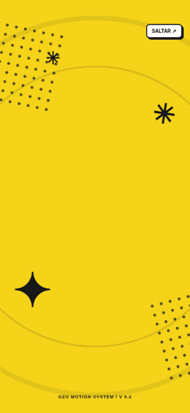
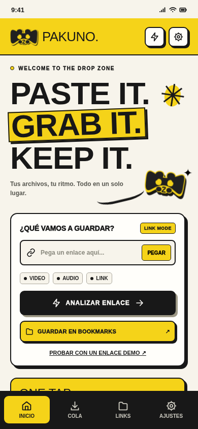
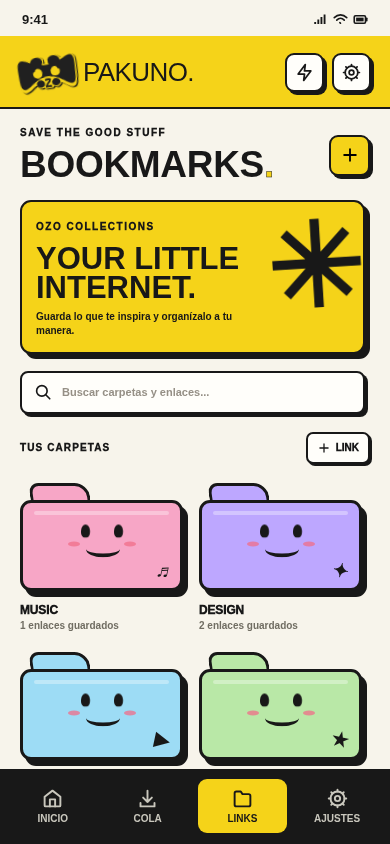

<div align="center">


# PAKUNO!

**by OZO**

**SAVE IT. GRAB IT. KEEP IT.**

*Your links, downloads, and favorite finds — in one playful little app.*

**NEO-BRUTALIST DESIGN** &nbsp;·&nbsp; **RUST + SLINT (PLANNED)** &nbsp;·&nbsp; **ANDROID FIRST** &nbsp;·&nbsp; **GPL-3.0**

🚧 **Early development — interactive design prototype available**

</div>

---

## ✦ Meet Pakuno

**Pakuno by OZO** is an upcoming lightweight mobile app built around two simple ideas: **download the media you're allowed to keep** and **save the links you don't want to lose**.

No clutter. No unnecessary accounts. Just a bold, animated, cartoon-inspired experience, featuring our little mascot, **OZO**. 💛🖤

## ✦ A little preview

<div align="center">
  
</div>

<p align="center">
  
  
</p>

> **Preview notice:** These images and the HTML demo are concept work, not screenshots of a finished native app. Downloads in the demo are simulated.

## ✦ What we're building

### ⬇️ Downloader

A friendly home for your downloads, with plans for:

- Individual media and file downloads from supported, authorized sources
- Playlist and batch selection, where technically supported and permitted
- Audio/video formats and selectable quality
- Download queue, progress, history, and retry controls
- Titles, artists, albums, artwork, and other available metadata
- Subtitles, captions, and chapters when available and compatible
- Easy **Save to Bookmarks** action for source links

**YouTube / YouTube Music:** Playlist handling is a research goal, **not** a currently supported feature. Actual capabilities will depend on technical feasibility, content rights, and platform terms. Pakuno is not intended to bypass DRM or access restrictions.

### 🔖 Bookmarks

A home for all the interesting corners of the internet:

- Colorful **neo-brutalist cartoon folders** with personality
- Custom names, colors, and organized collections
- Save links, notes, and playlist URLs
- Tags, favorites, search, and sorting
- Quick actions to share or open a link
- Offline-first local bookmark storage

## ✦ Design DNA

| Element | Approach |
| :-- | :-- |
| 🎨 Visual language | Neo-brutalism meets cartoon UI |
| 💛 Colors | Bold yellow, ink black, warm off-white, playful accents |
| ✨ Motion | Bouncy transitions, expressive folders, animated OZO |
| 📱 Experience | Touch-first, minimal screens, clear feedback |
| ⚡ Performance | Lightweight core, load expensive features only when needed |

## ✦ Planned tech stack

| Layer | Technology | Status |
| :-- | :-- | :-- |
| Core / download manager | **Rust** | Planned |
| Native UI | **Slint** | Planned |
| Local data | **SQLite** | Planned |
| First target | **Android** | Planned |
| Later target | **iOS** | Exploratory |
| Interactive design prototype | **HTML / CSS / JavaScript** | Available |

The native architecture may change as we validate platform APIs, media processing requirements, and performance on real devices.

## ✦ Roadmap

- [x] Define Pakuno's visual identity and OZO mascot
- [x] Build an animated HTML design prototype
- [ ] Set up the Rust + Slint mobile project
- [ ] Implement local bookmarks, folders, and search
- [ ] Add a permission-aware file download manager
- [ ] Add queue management and file library
- [ ] Research authorized playlist support and metadata handling
- [ ] Add supported subtitle and artwork workflows
- [ ] Test RAM, battery, storage, and performance on Android
- [ ] Explore iOS support

## ✦ Try the interactive prototype

This repository includes a **browser demo** to explore the look and feel before the native app is ready.

1. Download or clone this repository.
2. Open [`prototype/pakuno-motion-edition.html`](prototype/pakuno-motion-edition.html) in your browser.
3. Explore the animated navigation, OZO interactions, cartoon bookmark folders, and simulated download flow.

**No build tools required for the HTML preview.** It does not download real media.

## ✦ Repository layout

```text
pakuno/
├── README.md
├── LICENSE
├── .gitignore
├── assets/
│   ├── ozo-logo.png
│   ├── ozo-motion.gif
│   ├── preview-home.png
│   └── preview-bookmarks.png
└── prototype/
    └── pakuno-motion-edition.html
```

The Rust/Slint source tree will be introduced when the native implementation begins.

## ✦ Contributing

Issues, suggestions, and pull requests are welcome as the project takes shape. Please keep contributions aligned with the **Downloader + Bookmarks** scope and ensure that any added code or assets can be distributed under compatible terms. A dedicated contribution guide will be added later.

## ✦ Credits & inspiration

Pakuno by OZO is an independent app project developed with collaborators, with its own OZO mascot and neo-brutalist design. [LiquidCat](https://github.com/Kittora/LiquidCat) is a desktop project that helped inspire the downloader research. **No LiquidCat source code is included in this starter repository.** Any future code reuse must follow its applicable license.

## ✦ License

**Pakuno by OZO is free and open-source software licensed under the GNU General Public License v3.0 (GPL-3.0-only).**

You may use, study, modify, and redistribute the software under the conditions of the GPL v3.0. If you distribute modified versions covered by the GPL, you must also meet its source-code and licensing obligations. Commercial use is allowed under the license.

Copyright © 2026 OZO and Pakuno contributors.

See the full [LICENSE](LICENSE) file or read the [GNU GPL v3.0](https://www.gnu.org/licenses/gpl-3.0.en.html).

Third-party libraries, media, and artwork may have their own licenses; contributors must respect those terms. Reusing code from [LiquidCat](https://github.com/Kittora/LiquidCat) requires compliance with its license and applicable notices. Pakuno's name and visual identity do not imply endorsement by third-party services.

---

<div align="center">

**PAKUNO! by OZO** — *Save it. Grab it. Keep it.*

Made with ⚡, pixels, and a little bit of chaos.

</div>
